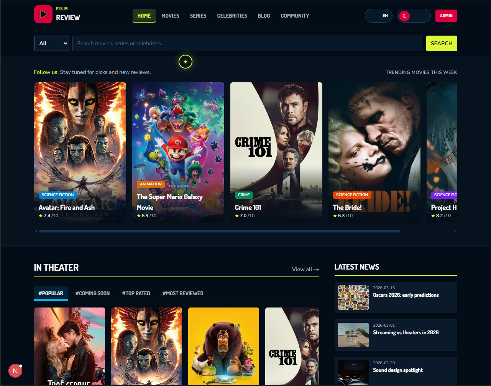

# Film Review Movie

Film, dizi ve ünlüleri gezip inceleyebileceğiniz bir Next.js uygulaması. Veriler `data/` klasöründeki JSON dosyalarından gelir; TMDB API anahtarı verirseniz liste ve detay sayfaları TMDB'den beslenir. Arayüz Türkçe ve İngilizce, içinde küçük bir blog ve basit bir yönetim paneli var. Portföy ve demo için yazıldı.

Canlı demo: [mihrimatrix.github.io/film-review-movie](https://mihrimatrix.github.io/film-review-movie/)

## Neler var

- Film, dizi ve ünlü listeleri; her biri için detay sayfası
- Türe, yıla, puana, yönetmene ve oyuncuya göre süzme, sıralama ve sayfalama
- TMDB anahtarı varsa canlı veri, yoksa `data/` klasöründeki örnekler
- Blog yazıları ve yazı detay sayfaları
- Topluluk, profil, favori ve puan ekranları (demo verisiyle)
- Film, dizi, ünlü ve blog içeriğini düzenleyen bir yönetim paneli (yalnızca sunucu modunda)
- Türkçe ve İngilizce arayüz

### Etkileşimler

Poster kartları imleci takip ederek eğilir, üzerlerinde ışık yansıması ve havada duran rozetler var. Karttaki ↻ düğmesine basınca kart döner ve arkasında yönetmen, süre, özet ile "Detaya git" bağlantısı çıkar; dokunmatik ekranlarda da çalışır. Puanı 8 ve üzeri olan yapımların kartında imlece tepki veren gökkuşağı renkli bir folyo var.

Ana sayfadaki slider kartları merkeze uzaklıklarına göre döndürür, ortadaki posterin renkleri arka plana yayılır. Başlıktaki zar (🎲) düğmesi bir kartı yavaşlayarak döndürüp rastgele bir filmde durdurur.

Kartlardan ve detay sayfalarından filmleri izleme listesine (♥) ekleyebilir, 10 yıldız üzerinden puan verebilirsiniz. Liste `/watchlist` sayfasında film ya da diziye göre süzülür. Bu veriler tarayıcının `localStorage` alanında durur ve açık sekmeler arasında eşitlenir.

Detay sayfalarında site içinde açılan bir fragman oynatıcı (YouTube nocookie), paylaş düğmesi (Web Share, desteklenmiyorsa panoya kopyalama), türe göre benzer yapımlar ve eğilen bir poster bulunur. Okuma ilerleme çubuğu, başa dön düğmesi ve aramaya odaklanan `/` kısayolu da var. Sistemde "hareketi azalt" (`prefers-reduced-motion`) açıksa animasyonlar kapanır.

## Teknolojiler

- `Next.js 16` (App Router)
- `React 19`
- `TypeScript`
- `Tailwind CSS 4`
- `GSAP` / `@gsap/react`

## Sayfalar

- Ana sayfa: `/`
- İzleme listem: `/watchlist`
- Filmler: `/movies`
- Diziler: `/series`
- Ünlüler: `/celebrities`
- Blog: `/blog`
- Topluluk: `/community/*`
- Yönetim girişi: `/admin/login`
- Yönetim paneli: `/admin`

## Kurulum

Node.js 20.9 veya üstü ve npm gerekir.

```bash
npm install
```

Proje kökünde bir `.env.local` dosyası oluşturun:

```bash
# zorunlu degil ama siddetle onerilir
TMDB_API_KEY=your_tmdb_api_key

# admin panel sifresi (tanimlanmazsa varsayilan: admin123)
ADMIN_PASSWORD=your_strong_password

# opsiyonel - admin oturum cerezini imzalayan sir (tanimlanmazsa sifreden turetilir)
ADMIN_SESSION_SECRET=long_random_string

# opsiyonel - canonical URL/SEO
NEXT_PUBLIC_SITE_URL=http://localhost:3000
```

TMDB API anahtarını [themoviedb.org/settings/api](https://www.themoviedb.org/settings/api) adresinden alabilirsiniz.

Geliştirme sunucusunu başlatın:

```bash
npm run dev
```

Uygulama [http://localhost:3000](http://localhost:3000) adresinde açılır.

## GitHub Pages

Site iki biçimde çalışır. `npm run build` ve `npm start` ile Node sunucusu olarak çalıştırdığınızda her şey açıktır. GitHub Pages ise yalnızca statik dosya sunar; bu yüzden `npm run build:pages` ayrı bir statik derleme üretir:

```bash
npm run build:pages   # çıktı: pages-dist/
```

Statik sürümde Türkçe site kök dizinde, İngilizce kopyası `/en` altında durur ve dil düğmesi aynı sayfanın öbür dildeki kopyasını açar. Arama ile "Bana sürpriz yap" sunucuya gitmek yerine derleme sırasında üretilen `catalog.json` dosyasını kullanır. Süzme, sıralama ve sayfalama tarayıcıda yapılır, bağlantılar yine paylaşılabilir. Yönetim paneli ve `/api` rotaları dosya yazmak için sunucuya ihtiyaç duyduğundan statik sürüme girmez. TMDB keşif bölümü yalnızca ilk sayfasını gösterir ve TMDB listeleri birkaç sayfayla sınırlıdır, çünkü her kayıt için ayrı bir HTML dosyası üretilir.

Yayın `.github/workflows/pages.yml` ile otomatik yapılır: `master` dalına her push'ta site derlenip yayına alınır. İlk kurulum için:

1. Repo ayarlarında Settings → Pages → Source olarak "GitHub Actions" seçin.
2. TMDB verisi istiyorsanız Settings → Secrets and variables → Actions altına `TMDB_API_KEY` ekleyin. Eklemezseniz site `data/` klasöründeki örneklerle çıkar.

Alt yol varsayılan olarak `/film-review-movie` olur. Workflow bunu GitHub'dan otomatik alır; elle derlerken `PAGES_BASE_PATH` ile değiştirebilirsiniz.

Windows'ta yerel `build:pages` çıktısında Next.js 16.3'ün bir hatası yüzünden sayfa ön yükleme dosyaları (`__next.*.txt`) iç içe klasörlere yazılıyor ve sayfa geçişlerinde 404 görünebiliyor. GitHub Actions Linux'ta çalıştığı için yayındaki site bundan etkilenmez.

## Docker ile çalıştırma

```bash
docker compose up --build
```

Uygulama `3000` portunda açılır. `data/` klasörü konteynerde `/app/data` olarak bağlanır, `ADMIN_PASSWORD` değeri compose ortamından okunabilir.

## Komutlar

```bash
npm run dev    # gelistirme
npm run build  # production build
npm run start  # production server
npm run build:pages # GitHub Pages icin statik cikti (pages-dist/)
npm run lint   # eslint
npm run tmdb:test   # TMDB_API_KEY ile API'ye tek istek (configuration)
```

### TMDB bağlantısını test etme

`.env.local` içinde `TMDB_API_KEY=...` tanımlıyken proje kökünde `npm run tmdb:test` çalıştırın. Bağlantı kurulursa `Basarili — API anahtari calisiyor` mesajı ve örnek bir `images.base_url` yazılır. Kurulamazsa HTTP kodu ya da ağ hatası (proxy, güvenlik duvarı) görünür.

Tarayıcıdan da deneyebilirsiniz, ama anahtarı içeren adresi kimseyle paylaşmayın:
`https://api.themoviedb.org/3/configuration?api_key=ANAHTARINIZ`

`tmdb:test` çalıştığı halde sitede TMDB verisi görünmüyorsa sebep genellikle şudur: `tmdb:test` `.env.local` dosyasını kendisi okur, Next.js ise ortam değişkenlerini yalnızca `npm run dev` (ya da `build`) başlarken yükler. `.env.local` dosyasını kaydettikten sonra geliştirme sunucusunu durdurup yeniden başlatın. Geliştirme sırasında `http://localhost:3000/api/dev/tmdb-status` adresini açın; `isTmdbConfigured: true` görmüyorsanız Next anahtarı hâlâ görmüyordur. Dosya adını, dosyanın proje kökünde olup olmadığını ve değişken adının `TMDB_API_KEY` olduğunu kontrol edin.

`/movies/interstellar` gibi sayfalar `data/movies.json` içindeki yerel kayıtlardır, TMDB'den gelmez. TMDB kayıtlarının slug'ı `tmdb-movie-...` ile başlar; onlara birleşik listedeki kartlardan ya da TMDB katalog bölümünden ulaşabilirsiniz.

## Veri

Uygulama verileri şu JSON dosyalarından okur:

- `data/movies.json`
- `data/series.json`
- `data/celebrities.json`
- `data/posts.json`
- `data/user.json`

Yönetim panelinden yapılan değişiklikler bu dosyalara yazılır. Docker'da `./data` bir volume olduğu için değişiklikler konteyner yeniden başlasa da kalır.

## Yönetim paneli girişi

Giriş `POST /api/admin/login` ile yapılır. Başarılı girişte `admin_session` çerezi oluşur. Çerezin değeri HMAC-SHA256 ile imzalanmış, süresi olan bir jetondur, bu yüzden elle yazılan ya da değiştirilen çerezler reddedilir. Şifre sabit zamanlı karşılaştırılır ve aynı IP'den 10 dakikada 8 hatalı denemeden sonra `429` döner. `/admin/*` ve `/api/admin/*` rotalarını `proxy` korur; `ADMIN_PASSWORD` değişince eski oturumlar geçersiz olur.

Canlıya çıkarken mutlaka kendi `ADMIN_PASSWORD` değerinizi tanımlayın. Varsayılan `admin123` yalnızca demo ve geliştirme içindir.

## Proje yapısı

```text
src/
  app/          # App Router sayfalari ve API route'lari
  components/   # UI bilesenleri
  lib/          # yardimci fonksiyonlar, i18n, veri ve servis katmani
data/           # yerel JSON verileri
public/         # statik varliklar
scripts/        # TMDB testi ve GitHub Pages derleme betigi
```

## Notlar

TMDB anahtarı olmadan da uygulama çalışır, yalnızca TMDB içerikleri yerine yerel örnekler görünür. Topluluk ve profil bölümlerinin bir kısmı demo verisi gösterir. TMDB kullanım bildirimi sitenin alt kısmında yer alır.
